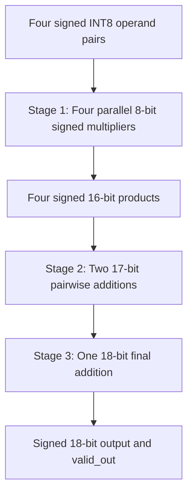

# Four-Lane INT8 Dot-Product Accelerator | RTL-to-GDSII

A three-stage pipelined, four-lane signed INT8 dot-product accelerator implemented in Verilog and taken through the complete RTL-to-GDSII flow using OpenROAD and the Nangate45 standard-cell library.

The project explores custom Baugh-Wooley multiplication and carry-save arithmetic to reduce hardware area while meeting a 500 MHz clock target.

## 1. Architecture

The accelerator computes:

    Y = (a0 × b0) + (a1 × b1) + (a2 × b2) + (a3 × b3)

Each input is a signed 8-bit integer.

### Three-stage pipeline

- Stage 1: Four parallel signed 8×8 multiplications
- Stage 2: Two pairwise additions
- Stage 3: Final accumulation

The datapath uses 16-bit products, 17-bit intermediate sums, and an 18-bit result.

A valid signal propagates through the pipeline to indicate valid output data.

## 2. Multiplier Architectures

Three implementations were evaluated.

### Baseline: Inferred Multiplication

Uses Verilog's signed multiplication operator (`*`) and allows Yosys to infer and map the multiplier hardware.

### Custom Baugh-Wooley Carry-Save Multiplier

Generates signed partial products using the Baugh-Wooley method.

A carry-save reduction network compresses the partial products before the final addition.

### Optimized Carry-Save Multiplier

Further modifies the final arithmetic stage by incorporating the Baugh-Wooley correction constant into a carry-save compression step.

This reduces the mapped standard-cell area while preserving functionality.

## 3. Verification

The signed INT8 multiplier was exhaustively tested against reference multiplication for all 65,536 input combinations.

The dot-product accelerator was also tested using directed and randomized input vectors.

## 4. Physical Design

Technology: Nangate45

Flow: OpenROAD-flow-scripts

Clock target: 2 ns (500 MHz)

Implementation stages:

1. RTL synthesis
2. Floorplanning
3. Placement
4. Clock-tree synthesis
5. Global and detailed routing
6. Static timing analysis
7. GDSII generation

## 5. PPA Comparison

| Metric | Baseline | Original CSA | Optimized CSA |
|---|---:|---:|---:|
| Synthesis area (um²) | 2974.15 | 2793.27 | 2784.49 |
| Final cell area (um²) | 3091 | 2983 | 2966 |
| Estimated Fmax (MHz) | 524.35 | 517.87 | 519.87 |
| Setup WNS (ns) | +0.09 | +0.07 | +0.08 |
| Hold violations | 0 | 0 | 0 |
| Final routing violations | 0 | 0 | 0 |

The optimized CSA implementation achieved a 4.04% reduction in final standard-cell area compared with the baseline while meeting the 500 MHz timing target.

The baseline retained a slightly higher estimated maximum frequency, illustrating the area-versus-timing trade-off.

## 6. Key Engineering Takeaways

- Implemented a custom signed multiplier architecture rather than relying exclusively on inferred multiplication.
- Used exhaustive functional testing to validate signed arithmetic.
- Examined post-route timing paths to identify arithmetic delay contributors.
- Compared architectural changes using synthesis and physical-design metrics.
- Demonstrated timing closure and generated routed GDSII layouts.

## 7. Tools

- Verilog
- SystemVerilog testbenches
- Icarus Verilog
- Yosys
- OpenROAD
- OpenSTA
- Nangate45 standard-cell library

## Hardware Architecture

The accelerator computes a four-element signed INT8 dot product:

`y = a0*b0 + a1*b1 + a2*b2 + a3*b3`

The design uses a three-stage pipeline with a valid signal propagated through each stage.

### Multiplier Architectures

Three implementations were evaluated under identical physical-design constraints:

1. **Baseline:** Inferred signed multiplication using Verilog `*`.
2. **Original CSA:** Custom Baugh-Wooley signed multiplier with carry-save compression.
3. **Optimized CSA:** Baugh-Wooley multiplier with its correction constant incorporated into the final carry-save reduction.
